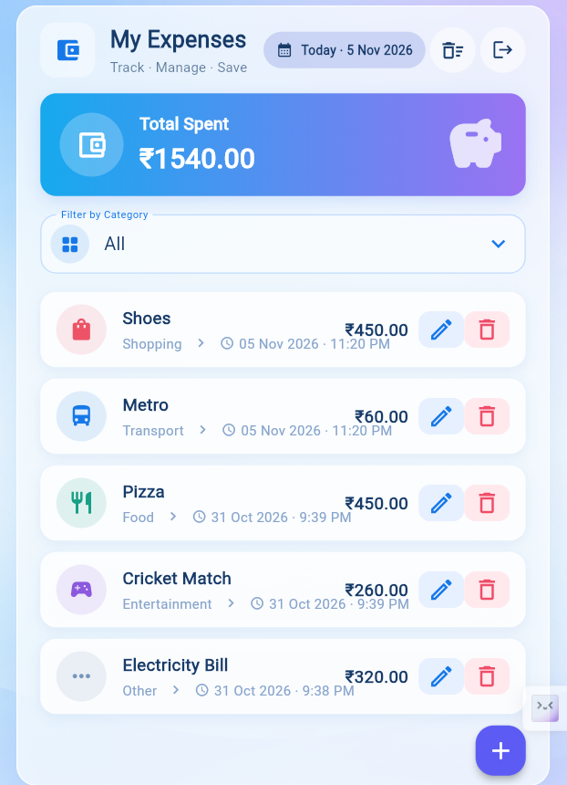
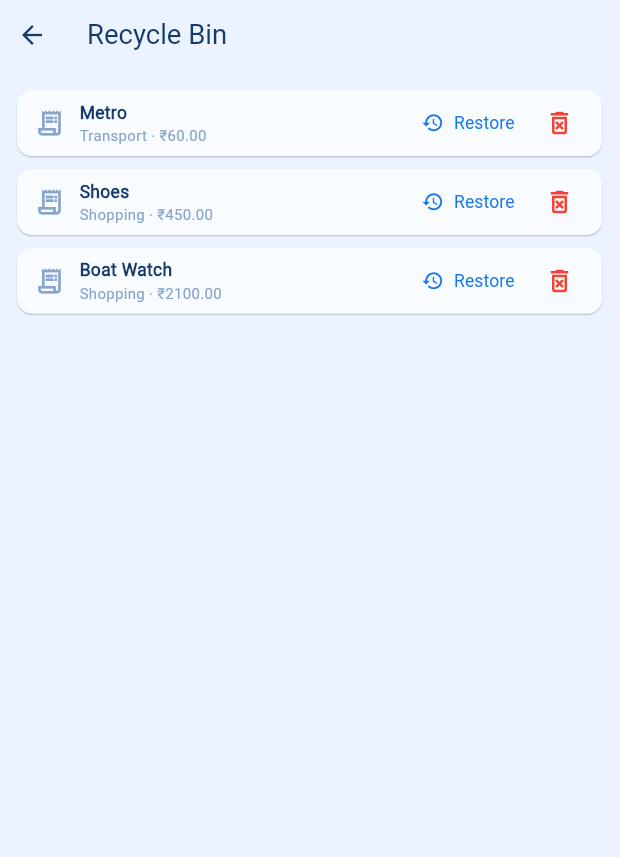

# 💰 Expensio – Expense Tracker

## 📱 Project Overview
Expensio is a Flutter-based expense tracking application that helps users manage daily expenses, monitor spending, and securely sync their financial records using Firebase.

## ✨ Features
- Google Sign-In & Authentication.
- Add, Edit and Delete Expenses.
- Track Total Expenses.
- Filter Expenses by Category.
- Firebase Firestore Cloud Storage.
- Recycle Bin with Restore & Permanent Delete.
- User-specific expense management.
- Responsive UI for Mobile and Web.

## 🛠️ Tech Stack
- **Framework:** Flutter
- **Language:** Dart
- **Authentication:** Firebase Authentication
- **Database:** Cloud Firestore
- **Login:** Google Sign-In
- **Local Storage:** SharedPreferences
- **Tools:** VS Code, Android Studio, Git & GitHub

## 📂 Folder Structure
```text
expensio/
├── assets/
│   └── images/
├── lib/
│   ├── models/
│   │   └── expense.dart
│   ├── screens/
│   │   ├── home_screen.dart
│   │   ├── add_expense_screen.dart
│   │   ├── google_sign_in_screen.dart
│   │   └── recycle_bin_screen.dart
│   ├── services/
│   │   ├── app_auth_service.dart
│   │   ├── expense_repository.dart
│   │   ├── firebase_app_auth_service.dart
│   │   └── firestore_expense_repository.dart
│   ├── firebase_options.dart
│   └── main.dart
├── screenshots/
├── test/
├── pubspec.yaml
└── README.md
```

## 📸 Screenshots

| Home Screen | Add Expense |
|---|---|
|  |  |

| Google Sign-In | Recycle Bin |
|---|---|
|  |  |

## 🚀 Installation Steps

1. Clone the repository:
```bash
git clone <YOUR_REPOSITORY_URL>
```

2. Navigate to the project:
```bash
cd expensio
```

3. Install dependencies:
```bash
flutter pub get
```

4. Configure Firebase and enable Google Sign-In and Cloud Firestore.

5. Run the application:
```bash
flutter run
```

## 👨‍💻 Author

**Bhupender**

- GitHub: [@bhupender1208](https://github.com/bhupender1208)
- LinkedIn: [Bhupender](https://www.linkedin.com/in/bhupender-00b134282/)